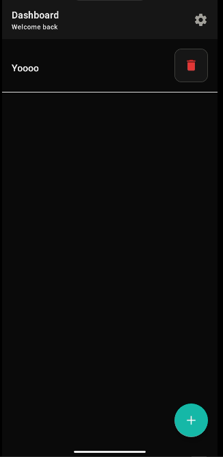
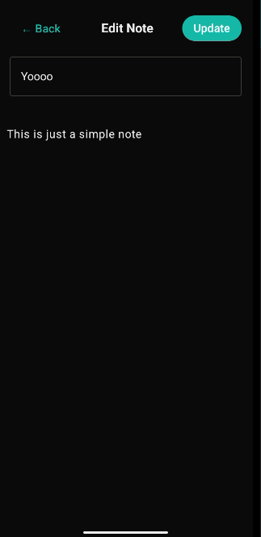
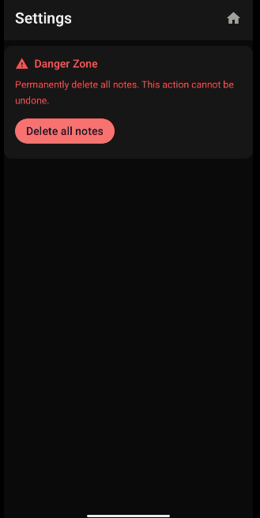

<div align="center">

# 📓 Notebook

**A fast, beautiful notebook app for your desktop. Built with Laravel + NativePHP (SUPERNATIVE).**


_Write it down. Find it fast. Keep it yours._

</div>
## Screenshots





---

## ✨ Features

- 📝 **Create, edit and delete notes** in a clean, distraction-free editor
- 💾 **Local-first storage** — your notes stay on your machine
- 🖥️ **Native desktop app** powered by NativePHP (no browser tab needed)
- ⚡ **Lightweight and fast** — built on Laravel, runs offline

> Edit this list to match what your app actually does.

## 🛠️ Tech stack

| Layer    | Tech                                           |
| -------- | ---------------------------------------------- |
| Backend  | Laravel (PHP)                                  |
| Desktop  | NativePHP (SuperNatve)                         |
| Database | SQLite                                         |
| Frontend | Blade / Livewire / Tailwind (adjust as needed) |

## 🚀 Getting started

### Requirements

- PHP 8.2+
- Composer
- Node.js and npm

### Installation

```bash
# Clone the repository
git clone https://github.com/your-username/your-repo.git
cd your-repo

# Install dependencies
composer install
npm install

# Set up environment
cp .env.example .env
php artisan key:generate

# Create the database and run migrations
#( Run this if the database sqlite file does not exist in the database folder, if it does not work, create the file manually)
touch database/database.sqlite


php artisan migrate
```

### Run in development

```bash
composer native:dev
```

Or, if your project uses the older command:

```bash
php artisan native:serve
```

### Run in development using Bifrost Jump

```bash
php artisan native:jump
```

### Build for production

```bash
php artisan native:build
```

Your installer will be generated for your current operating system.

## 📁 Project structure

```
app/            Application logic (models, controllers, components)
database/       Migrations and SQLite database
resources/      Views, fonts
routes/         App routes
```

## 🤝 Contributing

Contributions, issues and feature requests are welcome.

1. Fork the project
2. Create your branch: `git checkout -b feature/amazing-feature`
3. Commit your changes: `git commit -m "Add amazing feature"`
4. Push to the branch: `git push origin feature/amazing-feature`
5. Open a pull request

## 📄 License

Released under the [MIT License](LICENSE).

---

<div align="center">

Built with ❤️ using [Laravel](https://laravel.com) and [NativePHP](https://nativephp.com)

</div>
